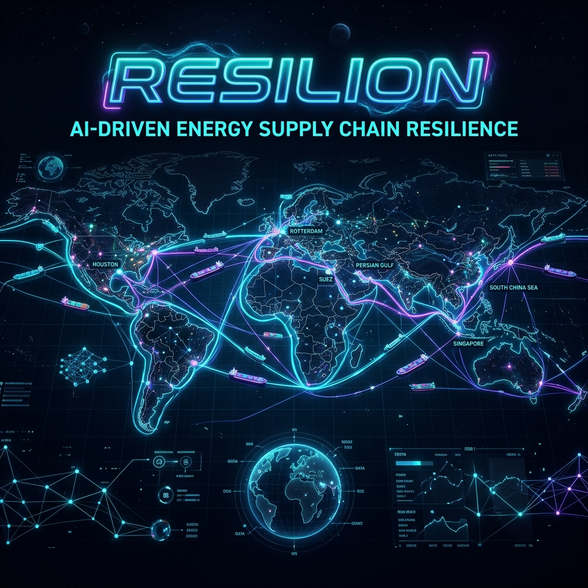
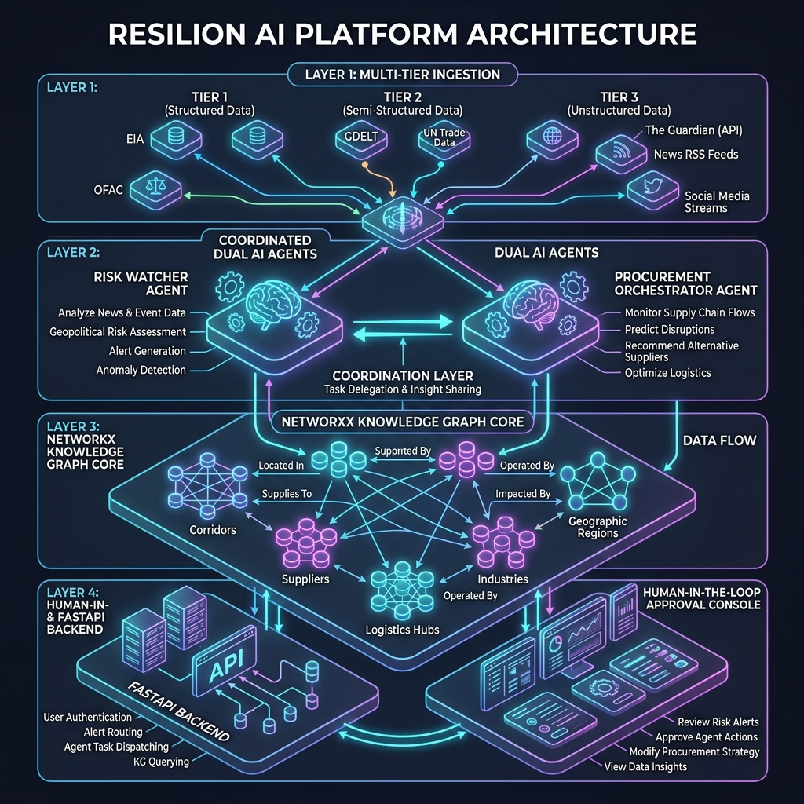
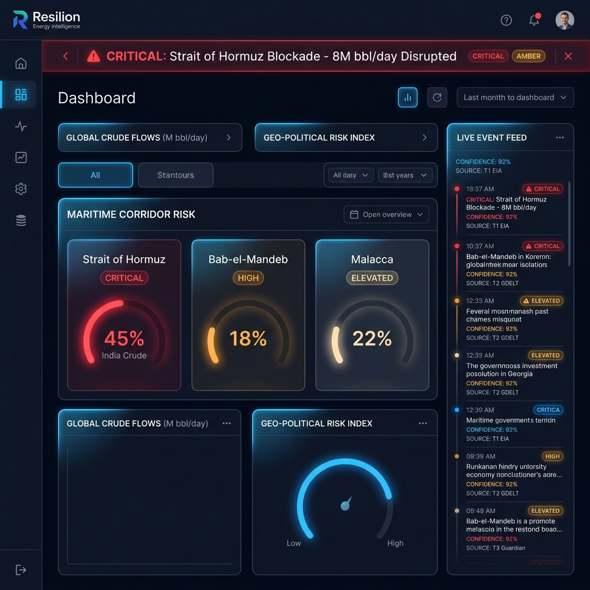
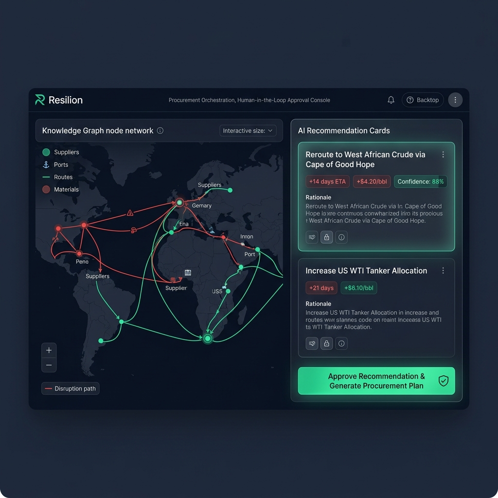

<div align="center">



# ⬡ RESILION
### *AI-Driven Energy Supply Chain Resilience & Geo-Risk Intelligence*

[](file:///home/kskroyal/Projects/re/Resilion-/backend/scripts/exit_criteria.py)
[](https://python.org)
[](https://fastapi.tiangolo.com)
[](https://reactjs.org)
[](https://networkx.org)
[](https://aistudio.google.com)
[](LICENSE)

<p align="center">
  <a href="#-executive-summary">Executive Summary</a> •
  <a href="#-system-architecture">Architecture</a> •
  <a href="#-key-features">Key Features</a> •
  <a href="#-dual-ai-agent-engine">Dual AI Agents</a> •
  <a href="#-user-interface">UI Console</a> •
  <a href="#-quick-start">Quick Start</a> •
  <a href="#-roadmap">Roadmap</a>
</p>

</div>

---

## 🌍 Executive Summary

Import-dependent economies face existential risks during sudden geopolitical maritime blockades. **India imports ~88% of its crude oil**, with **40-45% transiting the Strait of Hormuz** — a strategic bottleneck subject to critical military blockades and severe supply shocks (e.g. the 2026 US-Iran crisis driving Brent crude near \$110/bbl with ~8M bbl/day unavailable).

Traditional enterprise supply chain management tools fail during geopolitical crises because they rely on static ERP lookups and lack real-time signal processing. Conversely, raw LLM-based assistants are unsuitable for critical energy procurement because they suffer from hallucinations and lack verifiable graph traceability.

**Resilion** solves this by deploying **two coordinated AI agents** operating over a deterministic **NetworkX Knowledge Graph**:

1. **Risk Watcher Agent**: Ingests multi-tiered geopolitical news and raw data feeds (EIA, OFAC, GDELT, RSS), extracts structured disruption events, calculates source-confidence scores, and updates the knowledge graph.
2. **Procurement Orchestrator Agent**: Triggers on disruption signals, computes cascading supply impacts across refineries and downstream industries, ranks optimal alternative crude routes (e.g. West African crude via Cape of Good Hope, US WTI allocations), and generates graph-traced recommendations.

> **🛡️ Strict Human-in-the-Loop Governance:** No autonomous procurement order or rerouting action is auto-executed. All agent recommendations are backed by structural graph traversal proofs and require explicit human approval via the control dashboard.

---

## 🏗️ System Architecture



Resilion is built on a modular four-tier architecture designed for low-latency signal ingestion, graph propagation, and transparent human decisioning:

```
┌─────────────────────────────────────────────────────────────────────────┐
│                    LAYER 1: MULTI-TIER DATA INGESTION                   │
│  Tier 1 (Ground Truth): EIA Open Data, OFAC Sanctions List              │
│  Tier 2 (Corroborated Signal): GDELT Event Stream                       │
│  Tier 3 (Supporting Context): Guardian API, Maritime & Energy RSS       │
└────────────────────────────────────┬────────────────────────────────────┘
                                     │ Raw Articles & Structured Signals
                                     ▼
┌─────────────────────────────────────────────────────────────────────────┐
│                     LAYER 2: COORDINATED DUAL AGENTS                    │
│  ┌──────────────────────────────┐     ┌──────────────────────────────┐  │
│  │     RISK WATCHER AGENT       │     │   PROCUREMENT ORCHESTRATOR   │  │
│  │ • Structured Event Extraction│ ◄─► │ • Graph Traversal & Impact   │  │
│  │ • Source Tiering & Recency   │     │ • Route Cost & ETA Ranking   │  │
│  │ • Confidence Score Calc      │     │ • Rationale Proof Generation │  │
│  └──────────────────────────────┘     └──────────────────────────────┘  │
└────────────────────────────────────┬────────────────────────────────────┘
                                     │ Graph Mutations & Queries
                                     ▼
┌─────────────────────────────────────────────────────────────────────────┐
│                 LAYER 3: NETWORKX KNOWLEDGE GRAPH CORE                  │
│   Nodes: Corridors (3) | Refineries (3) | Suppliers (3) | Industries (4)  │
│   Edges: TRANSITS_THROUGH, SUPPLIES_TO, DEPENDS_ON, DISRUPTED_BY        │
└────────────────────────────────────┬────────────────────────────────────┘
                                     │ Real-time State & API Traces
                                     ▼
┌─────────────────────────────────────────────────────────────────────────┐
│              LAYER 4: FASTAPI BACKEND & HUMAN-IN-THE-LOOP UI            │
│  • RESTful API Endpoints (/api/events, /api/traversal, /api/approve)   │
│  • React Dark-Mode Command Center & Interactive Decision Console         │
└─────────────────────────────────────────────────────────────────────────┘
```

---

## ⚡ Key Features

- **📡 Multi-Tier Source Verification**:
  - **Tier 1 (Weight 1.0)**: Official government/regulatory sources (`EIA`, `OFAC`) represent ground truth.
  - **Tier 2 (Weight 0.7)**: Corroborated event databases (`GDELT`) provide rapid crisis signals.
  - **Tier 3 (Weight 0.4)**: Unstructured media news (`Guardian`, `RSS`) add qualitative context.
- **🧮 Mathematical Confidence Formula**:
  $$\text{Confidence} = 0.3 + 0.2 \times \min(\text{CorroboratingSources}, 3) + \text{RecencyMultiplier}$$
  Ensures unverified single-source claims never trigger critical procurement alerts.
- **🕸️ Structural Rationale Proofs**: Rationale for alternative crude sourcing is derived purely from NetworkX path traversals—eliminating free-text LLM hallucinations.
- **🚨 Monitored Strategic Corridors**:
  - **Strait of Hormuz** (~45% India crude transit — *CRITICAL*)
  - **Bab-el-Mandeb / Red Sea** (~18% India crude transit — *HIGH*)
  - **Strait of Malacca** (~22% India crude transit — *ELEVATED*)
- **🔒 Human-in-the-Loop (HITL) Audit Trail**: Every procurement rerouting recommendation includes complete cost impact (\$/bbl), transit delay (ETA +days), and an immutable approval record.

---

## 🤖 Dual AI Agent Engine

### 1. Risk Watcher Agent (`backend/agents/risk_agent.py`)
Monitored news feeds are ingested continuously. When a geopolitical incident occurs (e.g. missile attack or naval blockade), the Risk Watcher extracts structured entities using `gemini-2.5-flash`:

```json
{
  "event_id": "event:gdelt:20260714_hormuz_blockade",
  "corridor": "Strait of Hormuz",
  "severity": "CRITICAL",
  "impacted_capacity_bpd": 8000000,
  "confidence_score": 0.90,
  "sources": ["EIA", "GDELT", "GUARDIAN"]
}
```

### 2. Procurement Orchestrator Agent (`backend/graph/traversal.py`)
Upon receiving a `CRITICAL` risk node mutation, the Orchestrator executes breadth-first path traversals across the graph to map affected downstream Indian refineries (**Jamnagar**, **Panipat**, **Mumbai**) and consumer industries (**Power Generation**, **Petrochemicals**, **Aviation Fuel**, **LPG Distribution**).

It then ranks alternative crude suppliers:
- **West African Crude (Nigeria/Angola)** via Cape of Good Hope (+14 days transit, +\$4.20/bbl)
- **US WTI Export** via Atlantic/Cape routing (+21 days transit, +\$6.10/bbl)
- **Russian Urals Crude** via alternative sea corridors (+9 days transit, +\$2.80/bbl)

---

## 🖥️ User Interface

### 1. Threat Command Center & Corridor Risk Grid

*Real-time dark-mode command center displaying global crude flow disruption gauges, monitored corridor threat badges, active crisis ticker, and live multi-tiered intelligence feed.*

### 2. Knowledge Graph Explorer & HITL Approval Console

*Interactive graph traversal visualizer highlighting disruption cascade paths (red) alongside alternative rerouting options (green), complete with ETA/cost impact cards and single-click Human-in-the-Loop authorization.*

---

## 🚀 Quick Start

### Prerequisites
- **Python**: 3.10 or higher (Python 3.14+ supported)
- **Node.js**: v18.0 or higher
- **npm**: v9.0 or higher

### 1. Backend Setup

```bash
# Clone the repository
git clone https://github.com/Aditya2514/Resilion-.git
cd Resilion-/backend

# Create & activate a Python virtual environment
python3 -m venv .venv
source .venv/bin/activate        # Linux/macOS
# .venv\Scripts\activate         # Windows PowerShell

# Install dependencies
pip install -r requirements.txt

# Configure environment keys
cp .env.example .env
```

> **Note on API Keys**: Resilion works out of the box with public endpoints (`GDELT`, `OFAC`, `RSS`). For full access to EIA and Guardian feeds, edit `.env` and set `EIA_API_KEY`, `GUARDIAN_API_KEY`, and `GEMINI_API_KEY`.

### 2. Verify Phase 0 Exit Criteria

Run the automated verification suite to validate data ingestion, graph seeding, node traversal, and state persistence:

```bash
python scripts/exit_criteria.py
```

*Expected Output:*
```text
=================================================================
  RESILION — Phase 0 Exit Criteria
=================================================================
  [Step 1] Seeding reference graph...      [OK] (13 Nodes, 19 Edges)
  [Step 2] Live event ingestion...         [OK] (Live EIA/RSS Feed)
  [Step 3] EventNode construction...        [OK]
  [Step 4] SourceNode classification...     [OK] (Tier 3 Verified)
  [Step 5] Graph mutation & edge wiring...  [OK] (15 Nodes, 21 Edges)
  [Step 6] Downstream impact traversal...  [OK] (10 Industry Paths)
  [Step 7] State serialization...          [OK] (13.4 KB graph_state)
  [Step 8] Graph reload & integrity...     [OK] (Integrity Verified)
=================================================================
  Steps passed: 8/8  |  [PHASE 0 EXIT CRITERIA: PASSED ✅]
=================================================================
```

### 3. Frontend Setup

```bash
cd ../frontend

# Install Node dependencies
npm install

# Start Vite development server
npm run dev
```

Open your browser at `http://localhost:5173` to explore the Resilion interface.

---

## 🗺️ Project Roadmap & Phase Status

| Phase | Milestone | Status | Description |
|:---:|:---|:---:|:---|
| **Phase 0** | **Foundation & Graph Plumbing** | ✅ **PASSED** | Seeded NetworkX graph, live API fallbacks, state persistence, exit criteria verified |
| **Phase 1** | **Risk Intelligence Agent** | 🔄 **IN PROGRESS** | Gemini 2.5 Flash LLM extraction pipeline, structured schema validation |
| **Phase 2** | **Graph Traversal & Scoring** | 📅 **PLANNED** | Multi-hop disruption propagation algorithm, dynamic confidence decay |
| **Phase 3** | **Procurement Orchestrator** | 📅 **PLANNED** | Alternative route cost optimization, ETA impact ranking |
| **Phase 4** | **Human-in-the-Loop Console** | 📅 **PLANNED** | FastAPI approval endpoints, full React dashboard integration |
| **Phase 5** | **Historical Crisis Backtesting**| 📅 **PLANNED** | Validation against Feb–Jul 2026 Strait of Hormuz historical dataset |
| **Phase 6** | **Stretch Features** | 📅 **PLANNED** | Natural language graph querying, AIS live vessel integration |

---

## ⚠️ Disclosures & Ethics

- **Synthetic AIS Data**: Tanker position tracks depicted in UI mockups are **SYNTHETIC** demonstration models and not connected to a live AIS receiver.
- **No Financial Auto-Execution**: Resilion provides decision support only. All procurement orders, credit allocations, and ship charters require human sign-off.

---

<div align="center">

**Resilion Energy Intelligence** • Built for Hackathon 2026
*Protecting Economic Sovereignty Through Explainable Artificial Intelligence*

</div>
